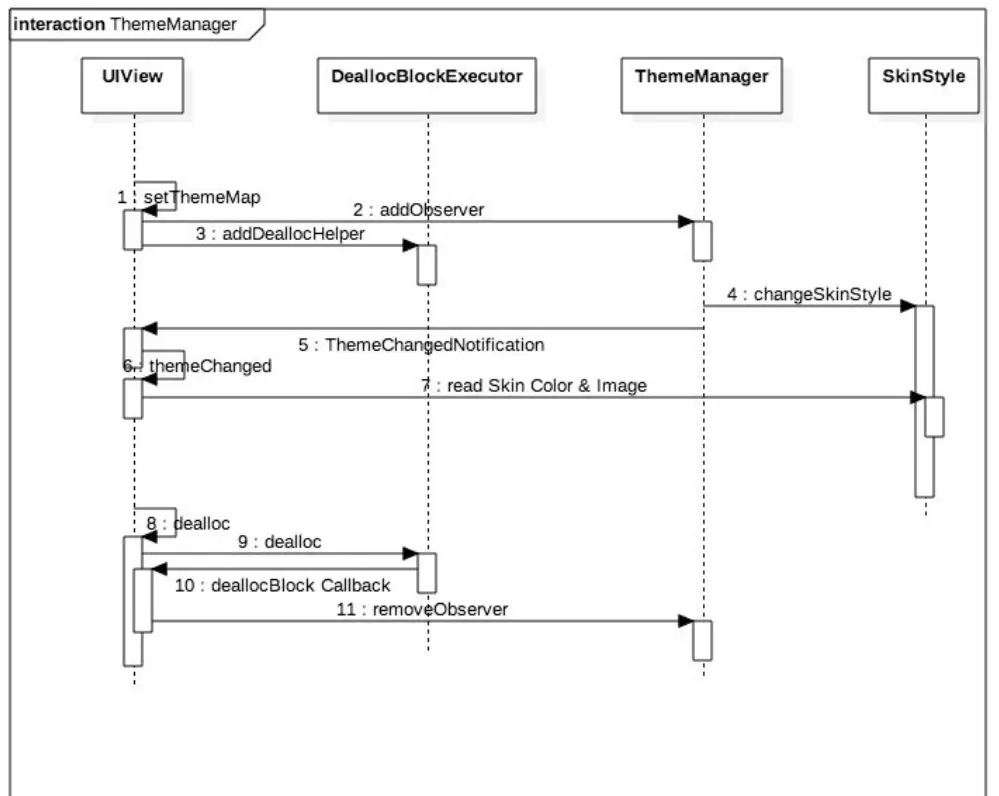

# CYLDeallocBlockExecutor【你好 block，再见 dealloc】

Hello block，byebye dealloc！一行代码代替dealloc完成“self-manager”

<p align="center">
<a href=""></a> <a href=""></a> <a href=""></a> <a href="https://github.com/ChenYilong/CYLDeallocBlockExecutor/actions/workflows/ci.yml"></a>
</a>


## 导航

  1.  [ 与其他框架的区别 ](https://github.com/ChenYilong/CYLDeallocBlockExecutor#与其他框架的区别) 
  2.  [ 使用CYLDeallocBlockExecutor ](https://github.com/ChenYilong/CYLDeallocBlockExecutor#使用cyldeallocblockexecutor) 
    1.   [第一步：使用cocoaPods导入CYLDeallocBlockExecutor](https://github.com/ChenYilong/CYLDeallocBlockExecutor#第一步使用cocoapods导入CYLDeallocBlockExecutor) 
    2.  [第二步：一行代码搞定](https://github.com/ChenYilong/CYLDeallocBlockExecutor#第二步一行代码搞定) 
    3.  [第三步](https://github.com/ChenYilong/CYLDeallocBlockExecutor#第三步) 
    4.  [生命周期 block](https://github.com/ChenYilong/CYLDeallocBlockExecutor#生命周期-block) 
  3.  [ 运行Demo ](https://github.com/ChenYilong/CYLDeallocBlockExecutor#运行demo)
  4.  [应用场景](https://github.com/ChenYilong/CYLDeallocBlockExecutor#应用场景) 
    1.  [管理KVO与NSNotificationCenter的removeObserver操作](https://github.com/ChenYilong/CYLDeallocBlockExecutor#管理kvo与nsnotificationcenter的removeobserver操作) 
    2.   [模拟weak修饰的property的生命周期](https://github.com/ChenYilong/CYLDeallocBlockExecutor#模拟weak修饰的property的生命周期)  
    3.   [更加安全地在 viewDidLoad 里管理应用的生命周期](https://github.com/ChenYilong/CYLDeallocBlockExecutor#更加安全地在viewdidload里管理应用的生命周期) 

## 与其他框架的区别

 -| 特点 |解释
-------------|-------------|-------------
1 | 轻量级、无污染 | 基于 NSObject 分类，无污染，适用于任何 NSObject 子类对象，比基于子类化、继承的框架更加轻量级。只用 dealloc block 时不做任何 hook；第一次给 UIViewController 添加生命周期 block 时，才为 UIViewController 安装一次生命周期 hook
2 | 高性能 | 使用 runtime 的对象关联（或称为关联引用）技术，随着关联对象的 dealloc，对应的 block 自发执行，性能消耗极低。
3 | 简单，无学习成本 | 一行代码完成，仅需使用  `cyl_willDealloc(selfCallback:)`  中的 block 代替  `dealloc` 即可。自动检测对象的 dealloc 的时机，执行 block。生命周期同样一行：`cyl_addLifecycleCallback(for: .viewWillAppear) { owner, identifier, info in }`
4 | 将分散的代码集中起来 | 你可以使用 [CYLDeallocBlockExecutor](https://github.com/ChenYilong/CYLDeallocBlockExecutor) 将  `KVO`  或 `NSNotificationCenter` 的 `addObserver` 和 `removeObserver`  操作集中放在一个位置，让代码更加直观，易于维护，demo 中也给出了相应的使用方法。
5 |支持CocoaPods |容易集成

（学习交流群：523070828）


## 使用[CYLDeallocBlockExecutor](https://github.com/ChenYilong/CYLDeallocBlockExecutor)

三步完成：

  1.  [ 第一步：使用cocoaPods导入CYLDeallocBlockExecutor ](https://github.com/ChenYilong/CYLDeallocBlockExecutor#第一步使用cocoapods导入CYLDeallocBlockExecutor) 
  2.  [第二步：一行代码搞定](https://github.com/ChenYilong/CYLDeallocBlockExecutor#第二步一行代码搞定) 
  3.  [第三步](https://github.com/ChenYilong/CYLDeallocBlockExecutor#第三步) 


### 第一步：使用CocoaPods导入CYLDeallocBlockExecutor


在 `Podfile` 中进行如下导入：


 ```ruby
pod 'CYLDeallocBlockExecutor'
 ```


然后使用 `cocoaPods` 进行安装：

如果尚未安装 CocoaPods, 运行以下命令进行安装:


 ```bash
gem install cocoapods
 ```


安装成功后就可以安装依赖了：

建议使用如下方式：

 ```bash
 # 禁止升级CocoaPods的spec仓库，否则会卡在 Analyzing dependencies ，非常慢 
 pod update --verbose --no-repo-update
 ```


如果提示找不到库，则可去掉 --no-repo-update


 ```bash
pod update
 ```


### 第二步：导入头文件

导入头文件：

 ```swift
// 无需导入头文件：库本身即为 Swift，随 Pod 引入即可
 ```

使用方法：

一行代码代替 dealloc：

 ```swift
        foo.cyl_willDealloc { owner, identifier in
            // do something
        }
 ```

这里注意：在 `cyl_willDealloc(selfCallback:)` 的参数 block 中不能使用 weak 修饰符修饰的 self，因为 weak 变量在 dealloc 中会被自定置为 nil。在使用 `cyl_willDealloc(selfCallback:)` 你需要遵循一个准则：

 > 参数 block 中的内容可以完全放入 dealloc。

因为该 block 就是在 dealloc 执行的时候执行的！


 ```swift
        cyl_willDealloc { owner, identifier in
            NotificationCenter.default.removeObserver(owner.takeUnretainedValue())
        }
 ```


### 取消回调

`cyl_willDealloc(selfCallback:)` 会返回任务标识（`UInt`），可用它取消；回调按添加顺序依次执行：

 ```swift
let id = foo.cyl_willDealloc { owner, identifier in /* ... */ }

foo.cyl_cancelDeallocCallback(identifier: id)   // 取消单个，返回是否成功
foo.cyl_cancelAllDeallocCallbacks()             // 取消全部
 ```

回调里的 `owner` 是 `Unmanaged<AnyObject>`（对应 Objective-C 的 `__unsafe_unretained id`），对象此时正在销毁：不要持有或让它逃出 block，需要时用 `owner.takeUnretainedValue()`。

### 生命周期 block

除了 dealloc，还可以在 UIViewController 的生命周期里执行 block，同样是一行代码，同样可以添加多个、按添加顺序执行、按标识取消：

 ```swift
cyl_addLifecycleCallback(for: .viewWillAppear) { owner, identifier, info in
    // owner 的类型就是当前类，不需要捕获 self
}
 ```

执行时机由 `timing` 参数控制（以调用 UIKit 实现的 `super` 为界）：

timing | 执行时机
-------|------
`.beforeSuper` | 顶部，`super` 之前
`.afterSuper`（默认） | 顶部，`super` 之后
`.end` | 底部，方法末尾（类重写了该方法时，需在重写里调用 `cyl_performLifecycle`，见 docs）

支持的事件：`viewDidLoad`、`viewWillAppear`、`viewIsAppearing`、`viewDidAppear`、`viewWillLayoutSubviews`、`viewDidLayoutSubviews`、`viewWillDisappear`、`viewDidDisappear`、`viewSafeAreaInsetsDidChange`、`viewLayoutMarginsDidChange`、`traitCollectionDidChange`、`viewWillTransition`、`willMoveToParent`、`didMoveToParent`、`didReceiveMemoryWarning`。

常用写法：

 ```swift
// 只执行一次的布局 block（可用 cyl_rearmLifecycleCallbacks(for:) 重新启用）
cyl_addLifecycleCallback(for: .viewDidLayoutSubviews, timing: .end, invokeOnce: true) { owner, _, _ in
    owner.setUpBadges()
}

// 深色模式切换时重新换肤
cyl_addLifecycleCallback(for: .traitCollectionDidChange) { owner, _, info in
    guard owner.traitCollection.hasDifferentColorAppearance(comparedTo: info.previousTraitCollection) else { return }
    owner.applyTheme()
}

// 用 key 替换：同一个 key 只保留最后添加的 block（setter 多次调用也只有一个）。
// 带 key 的 block 归持有 key 的一方所有：cyl_cancelAll… 与按事件 re-arm 不会影响它，用 cyl_cancelDeallocCallback(key:) 等按 key 操作
cyl_willDealloc(key: "theme.removeObserver") { owner, _, _ in
    NotificationCenter.default.removeObserver(owner.takeUnretainedValue())
}
 ```

dealloc 也有了相同参数的版本：`cyl_willDealloc(callback:)`（owner、identifier、info），与生命周期 block 共用标识序列、锁和取消方式；原来的 `cyl_willDealloc(selfCallback:)` 不变。

完整设计（自动派发、手动派发、与 CYLTabBarController 的对应关系）见 [docs/Lifecycle-Callbacks.md](docs/Lifecycle-Callbacks.md)。

### 从 Objective-C 版本迁移

Objective-C | Swift
------------|------
`cyl_willDeallocWithSelfCallback:` | `cyl_willDealloc(selfCallback:)`
`cyl_cancelDeallocCallbackWithIdentifier:` | `cyl_cancelDeallocCallback(identifier:)`
`cyl_cancelAllDeallocCallbacks` | `cyl_cancelAllDeallocCallbacks()`
`cyl_executeAtDealloc:`（已废弃） | `cyl_executeAtDealloc(_:)`（已废弃）
`CYLDeallocCallbackIllegalIdentifier` | `CYLDeallocCallbackIllegalIdentifier`

### 第三步

没有第三步！


## 运行Demo

示例 Demo 展示了一个自动换皮肤的功能，

在 demo 中我们使用了 UIView 的一个分类来管理皮肤，并在分类中设置了一个皮肤主题属性，并且使用了通知进行换皮肤操作，所有的 `addObserver` 和 `removeObserver` 操作都在皮肤属性的 setter 方法中实现。


运行好 demo后，请点击设备屏幕，会触发换主题（背景）的事件。


## 应用场景

### 管理KVO与NSNotificationCenter的removeObserver操作

在 `KVO` 、 `NSNotificationCenter` 在 `addObserver` 后，都需要在  `dealloc`  方法中进行 `removeObserver`  操作，一方面代码分散，不易维护，


另一方面如果想在分类中使用 `KVO` 、 `NSNotificationCenter` ，而你又想在  `dealloc`  中进行 `removeObserver` 操作，那应该怎么办？

答：你需要借助 [CYLDeallocBlockExecutor](https://github.com/ChenYilong/CYLDeallocBlockExecutor) ！

Demo 中给出了一个换皮肤的 Demo，演示：

所有的的操作全部都在 Setter 方法中进行，无需借助 Dealloc 方法。

 ```swift
var themeMap: [String: Any]? {
    get { objc_getAssociatedObject(self, &themeMapKey) as? [String: Any] }
    set {
        objc_setAssociatedObject(self, &themeMapKey, newValue, .OBJC_ASSOCIATION_COPY_NONATOMIC)
        if let themeMap = newValue {
            // Need to removeObserver at dealloc
            // NOTE: owner is unretained because a weak reference is already nil during dealloc
            cyl_willDealloc { owner, identifier in
                NotificationCenter.default.removeObserver(owner.takeUnretainedValue())
            }
            NotificationCenter.default.removeObserver(self, name: kThemeDidChangeNotification, object: nil)
            NotificationCenter.default.addObserver(self,
                                                   selector: #selector(themeChanged(_:)),
                                                   name: kThemeDidChangeNotification,
                                                   object: nil)
            themeChanged(with: themeMap)
        } else {
            NotificationCenter.default.removeObserver(self, name: kThemeDidChangeNotification, object: nil)
        }
    }
}
 ```

对应的时序图如下所示：





直接从看图里的第8步骤开始看：
 [CYLDeallocBlockExecutor](https://github.com/ChenYilong/CYLDeallocBlockExecutor) 所起作用的地方从第8步骤开始。

### 模拟weak修饰的property的生命周期

我曾经在我的一篇博文中使用过类似的策略：


全文见： [《runtime 如何实现 weak 属性》]( https://github.com/ChenYilong/iOSInterviewQuestions/blob/master/01《招聘一个靠谱的iOS》面试题参考答案/《招聘一个靠谱的iOS》面试题参考答案（上）.md#8-runtime-如何实现-weak-属性 ) 

下面做下简要叙述：


我们都知道@property的 weak 属性：


 > weak 此特质表明该属性定义了一种“非拥有关系” (nonowning relationship)。为这种属性设置新值时，设置方法既不保留新值，也不释放旧值。此特质同 assign 类似， 然而在属性所指的对象遭到摧毁时，属性值也会清空(nil out)。


那么如何让不使用weak修饰的@property，拥有weak的效果？

代码如下所示：


 ```swift
private var objectKey: UInt8 = 0

class Holder: NSObject {
    // 不使用 weak 修饰，却拥有 weak 的效果：object 销毁时自动置 nil
    var object: NSObject? {
        get { objc_getAssociatedObject(self, &objectKey) as? NSObject }
        set {
            objc_setAssociatedObject(self, &objectKey, newValue, .OBJC_ASSOCIATION_ASSIGN)
            newValue?.cyl_willDealloc { [weak self] _, _ in
                // owner 已在销毁中，这里只清掉 self 上的关联引用，避免悬垂指针
                guard let self = self else { return }
                objc_setAssociatedObject(self, &objectKey, nil, .OBJC_ASSOCIATION_ASSIGN)
            }
        }
    }
}
 ```

这样就达到了当 object 为 nil 时，自动将 self.object 置 nil 的目的，从而就模拟了weak修饰的property的生命周期。

### 更加安全地在 viewDidLoad 里管理应用的生命周期

在我的一个框架 [CYLTabBarController](https://github.com/ChenYilong/CYLTabBarController) 中，有一个KVO注册与反注册的实现：

 ```swift
override func viewDidLoad() {
    super.viewDidLoad()
    // 处理tabBar，使用自定义 tabBar 添加 发布按钮
    setUpTabBar()
    // KVO注册监听
    if !isObservingSwappableImageViewDefaultOffset {
        tabBar.addObserver(self, forKeyPath: "swappableImageViewDefaultOffset", options: .new, context: CYLSwappableImageViewDefaultOffsetContext)
        isObservingSwappableImageViewDefaultOffset = true
    }
    delegate = self
}

deinit {
    // KVO反注册
    if isObservingSwappableImageViewDefaultOffset {
        tabBar.removeObserver(self, forKeyPath: "swappableImageViewDefaultOffset")
    }
}
 ```

也许你会很奇怪为什么有一个flag在做判断，那是因为 viewDidLoad 在一些场景下没有被调用，但 dealloc 却被调用了。。。什么场景？当 [CYLTabBarController](https://github.com/ChenYilong/CYLTabBarController) 被作为StoryBoard的初始控制器，但是你又重写了下面的方法：

 ```swift
func application(_ application: UIApplication,
                 didFinishLaunchingWithOptions launchOptions: [UIApplication.LaunchOptionsKey: Any]?) -> Bool {
    if !isUserLogin {
        let login = UIStoryboard(name: "Main", bundle: nil).instantiateViewController(withIdentifier: "LoginViewController")
        window?.rootViewController = login
    }
    return true
}
 ```

Demo 我已经放在仓库里，叫做 CYLTabBarControllerTestDemo
，[CYLTabBarController](https://github.com/ChenYilong/CYLTabBarController) 版本 1.5.5 及之前的版本因为没有 flag 判断，直接会 crash 掉。Demo 的 Podfile 现已固定到 CYLTabBarController 最新提交。
这种场景下我这里采用了 flag 来规避，其实也可以用 CYLDeallocBlockExecutor 来达到目的。在 viewDidLoad 做 dealloc 该做的事，即使 viewDidLoad 没有被调用，也没有关系，block里的内容也不会被执行。

用本库改写后不再需要 flag：在添加监听的地方，同时添加移除监听的 dealloc block。注意要直接捕获被监听的对象，不要在 block 里通过 owner 读取（dealloc 时 owner 的属性可能已经释放）：

 ```swift
override func viewDidLoad() {
    super.viewDidLoad()
    let observedTabBar = tabBar
    observedTabBar.addObserver(self, forKeyPath: "swappableImageViewDefaultOffset", options: .new, context: nil)
    cyl_willDealloc(key: "kvo.swappableImageViewDefaultOffset") { owner, _, _ in
        observedTabBar.removeObserver(owner.takeUnretainedValue() as! NSObject, forKeyPath: "swappableImageViewDefaultOffset")
    }
}
 ```

同时，如果用 KVO 监听 iVar，如果由于不能确定 iVar 是否为 nil，那么你就可以做出判断，只在有值时监听。同时，释放 KVO 的行为，就可以借助本库，放在这个是否有值的判断里。这样就达到了只在有值时监听，同时在 self 销毁时释放的效果。

（更多iOS开发干货，欢迎关注  [微博@iOS程序犭袁](http://weibo.com/luohanchenyilong/) ）


## 补充知识

### `__unsafe_unretained` 与 Swift

Objective-C 中 `__unsafe_unretained` 的行为对应 Swift 中的 `unowned(unsafe)`：不改变引用计数，对象释放后也不会自动置 `nil`，继续访问会得到未定义行为。因此回调里的 `owner` 只能在 block 内部临时使用。

在销毁阶段，`weak` 引用已经被置 `nil`，所以必须使用不持有的引用（本库用 `Unmanaged<AnyObject>`）才能拿到“正在销毁”的对象。

----------
Posted by [微博@iOS程序犭袁](http://weibo.com/luohanchenyilong/)  
原创文章，版权声明：自由转载-非商用-非衍生-保持署名 | [Creative Commons BY-NC-ND 3.0](http://creativecommons.org/licenses/by-nc-nd/3.0/deed.zh)

