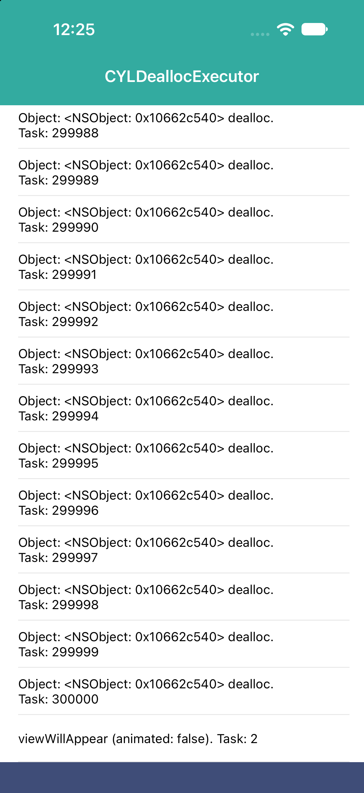
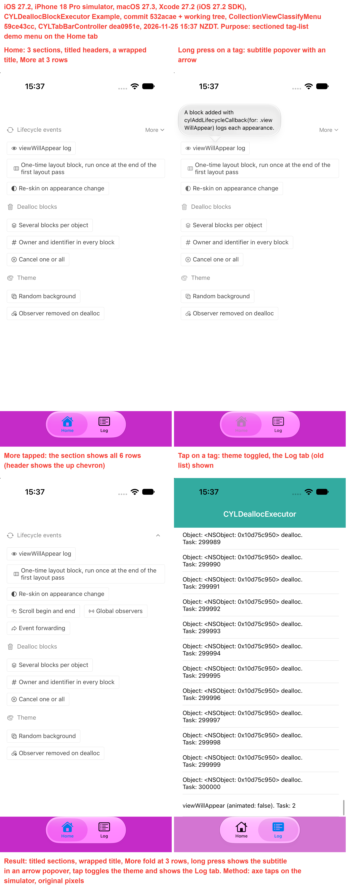
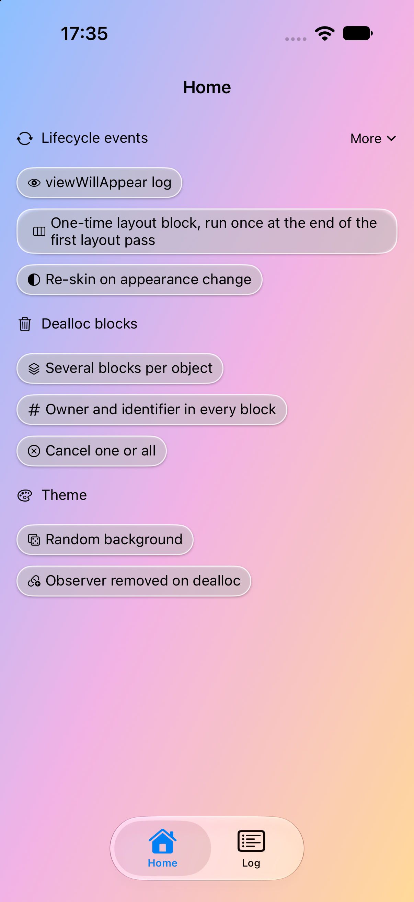
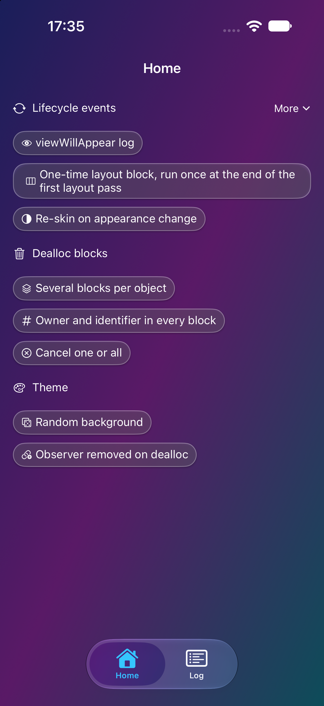

# Lifecycle callbacks

This document tracks the lifecycle block API of CYLDeallocBlockExecutor: blocks run at UIKit lifecycle events of an object, in the same way as the dealloc block. The API will become a core dependency of [CYLTabBarController](https://github.com/ChenYilong/CYLTabBarController), which will use it for its layout block and its theme (skin) interfaces, as the README describes for the dealloc block.

## Task log

### TODO: round 18, advisor review of the all-platform score and the next plan (2026-11-24, branch `integration/round-18`)

**Context.** Round 17 ended at an effect score of about 90.2 / 100 (cell score 205 / 205, saturated). Review, deductions and plan: [Cross-Platform-API.md](Cross-Platform-API.md#round-18-advisor-review-2026-11-24).

**Requirements (English translation of the prompt).**

- The advisor (Opus) reviews the current score of the all-platform interface work and gives the next plan and advice.
- Sonnet, the default model, implements the advice right away, to bring the score to 100.
- Forward the fitting tasks to the other sessions, which test on their own machines: iOS on the macOS machine, every other platform on the Windows machine. Do not wait for CI before forwarding.

**Follow-up (2026-11-24).** No Windows session is reachable; the owner said "run on Mac": the Android, Flutter, React Native and HarmonyOS rows of the round 18 handoff run on this Mac's emulators (Mini Program still needs Windows A or the WeChat login). Prompt (verbatim): run on Mac

**Prompt (verbatim).** continue TODO (missing points): advisor opus advisor点评目前全平台接口实现得分 以及下一步计划与建议。并立即让默认模型sonnet按照建议去实现。将得分优化到100转发合适任务给其他session 直接使用本机环境进行测试，iOS在macos机器，其余在windows机器。转发任务给相应session无需等待ci结果。

### TODO: observable moments for badges, animation and scrolling (2026-11-23, branch `feat/lifecycle-callbacks`, PR #12)

**Context.** The lifecycle blocks cover view controller events and dealloc. CYLTabBarController's badge extensions touch `UIViewController`, `UITabBarItem`, `UIControl`, `UIView` and `UIBarButtonItem`, decide readiness with `cyl_isReady()`, and play animations. The owner wants every such moment observable from this library on every platform.

**Requirements (English translation of the prompt).**

- The lifecycle is still not enough: lifecycle management is missing wherever badges are involved: `UIViewController`, `UITabBarItem`, `UIControl`, `UIView`, and the way a badge decides it is ready.
- This repository must report these moments: a `UIViewController`, `UITabBarItem`, `UIControl` or `UIView` appearing and leaving the screen; the user scrolling the scroll view of a view controller; a badge appearing; an animation starting and ending.
- Use case: when the user scrolls, pause every animation, and resume after the scrolling ends. Users and developers customize behavior at those moments through this library.
- The advisor designs the API, Sonnet implements it, on all platforms.

**Prompt (verbatim).** 我对现在的生命周期还是不满意，缺少很多必要的生命周期管理。请advisor继续评估我的需求，参考iOS上cylbadge系列分类方法所涉及的控件，包括，uiviewcontroller uitabbaritem uicontrol uiview，包括badge用来判断ready状态的方式，这些只要badge涉及到的，都需要进行生命周期管理。我预期的场景是，本仓库代码能完整获取到以下时机，uiviewcontroller uitabbaritem uicontrol uiview，出现 移出屏幕，用户正在滚动uiviewcontroller所在scrollview屏幕，以及badgd出现，动画开始动画结束的时机，我期望能通过本仓库达到监听目的，比如我可以借助本仓库决定当用户滚动屏幕的时候，暂停所有动画的播放，并在滚动结束后恢复状态。我想让用户以及开发者可以借助本仓库自定义行为在特定时机。请advisor设计api接口，sonnet负责实现。该要求适用于所有平台。

**Plan.** Design v5 below; library first (iOS, then Android, React Native, HarmonyOS, Mini Program, Flutter), then CYLTabBarController calls it. Tables and score: this document and [Cross-Platform-API.md](Cross-Platform-API.md).

### DONE: all-platform interface design aligned with iOS (2026-11-23, branch `feat/lifecycle-callbacks`, PR #12)

**Result.** 145 / 145, score 100, provisional ([Cross-Platform-API.md](Cross-Platform-API.md)). Still unverified: no device, emulator, hvigor or WeChat devtools run; the real `rootWindowInsets` read on Android; Flutter not re-run on the machine that did the Android, HarmonyOS and Mini Program work.

**Context.** The iOS API (this document) is the reference. Table, evidence rule, per-platform score and progress: [Cross-Platform-API.md](Cross-Platform-API.md). Platforms: Android (Kotlin), Flutter (Dart), React Native (TypeScript), HarmonyOS (ArkTS), WeChat Mini Program.

**Requirements (English translation of the prompt).**

- Continue with the all-platform interface design and the interfaces aligned with the iOS side; design a scoring system. Column 1 is iOS; add one column per platform.
- Find the related document (create it if missing, insert if it exists), in English: a table with column 1 (the feature, iOS), column 2 the feature description, then the matching API or feature per platform, TODO by default.
- Score: no TODO = full score, all TODO = 0. Loop: (1) search the existing code to match TODO cells; (2) score; (3) work through the TODO cells one by one and replace TODO with the implementation; (4) score again; repeat until full score.

**Prompt (verbatim).** 继续完成全平台接口设计与iOS端对齐接口，设计评分系统，第一列 ios, 增加各个平台对应接口。为一列，找到下面描述中相关的文档，如果没有就新建，如果有就插入：全英文写入：制作一个表格，第一列为，第二列为功能描述，第三列为 对应的api或者功能。第三列默认为TODO。制作评分系统，第三列没有TODO 为满分，全部是TODO为0分。制作表格以及评分系统完成后，第一步 尝试搜索现有代码，尝试匹配TODO项，寻找对应的api和功能。第二：打分。第三：。开始逐一处理TODO。并更新TODO为对应实现。第四步骤：打分。如此循环往复一直到满分为止。

### DONE: resolve this repository's GitHub issues (2026-11-22, branch `feat/lifecycle-callbacks`, PR #12)

**Result.** 7 / 7 rows, 100 / 100 ([Issues.md](Issues.md)). Tests 57/57 in Debug and Release on iOS 27.2, Debug on iOS 17.5. Transcriptions posted on #7 and #8; #5, #7 and #8 closed after the advisor's review.

**Context.** 7 issues (3 open: #5, #7, #8). #7 and #8 hold code as screenshots plus garbled OCR text. Table, score and progress: [Issues.md](Issues.md).

**Requirements (English translation of the prompt).**

- Read every issue of this project and the issues linked from them, and resolve them. Read every code description in detail; code appears as images and as OCR text. Where the OCR text is garbled, post the code from the image as a comment.
- The advisor designs the fix from the issue descriptions. Find the related document (create it if missing, insert if it exists), in English: a table with column 1 (the issue), column 2 the feature description, column 3 the matching API or feature, TODO by default.
- Score: no TODO in column 3 = 100, all TODO = 0. Then loop: search the existing code to match TODO rows, score, fix the TODO rows one by one and replace TODO with the implementation, score again, until 100.
- Sonnet implements; the advisor reviews whether the issues are done and gives the score; close the issues at 100.

**Prompt (verbatim).** 阅读所有本项目的issues，关联issues，并解决issues， 详细阅读里面所有关于代码相关的描述， 代码含有图片版本和图片识别版本， 如果图片的文字识别乱码，将图片里的代码更新到评论中，并根据issues描述，advisor设计如何解决，找到下面描述中相关的文档，如果没有就新建，如果有就插入：全英文写入：制作一个表格，第一列为，第二列为功能描述，第三列为 对应的api或者功能。第三列默认为TODO。制作评分系统，第三列没有TODO 为满分，全部是TODO为0分。制作表格以及评分系统完成后，第一步 尝试搜索现有代码，尝试匹配TODO项，寻找对应的api和功能。第二：打分。第三：。开始逐一处理TODO。并更新TODO为对应实现。第四步骤：打分。如此循环往复一直到满分为止。 默认模型sonnet 负责实现， 最终通过advisor审查是否完成issues任务并由advisor负责打分，满分后关闭issues

### TODO: re-evaluate the `cyl_` / `CYL` prefixes with static analysis (2026-11-22, branch `feat/lifecycle-callbacks`, PR #12)

**Context.** SonarCloud on CYLTabBarController PR #788: 956 open issues, 743 of them `swift:S100` (function names must match `^[a-z][a-zA-Z0-9]*$`, so every `cyl_foo` fails), 146 `swift:S115` (constants), 16 `S116`, 11 `S117`, 3 `S101` (class names). This repository has no SonarCloud project; Sonar's default Swift rules apply. None of this library's members are `@objc`. 1.4.0 is not released, so its new API can be renamed for free; the 1.3.0 names stay as deprecated shims.

**Requirements (English translation of the prompt).**

- Find this project's instructions files and skills files; create them when missing; write in English.
- Using the static analysis report in the GitHub pull request comments, re-evaluate the `cyl_` method prefix and the `CYL` class prefix in the instructions. The prefix exists for Objective-C: a category method can override another implementation with the same name, and Objective-C has no namespaces, so class names collide.
- Re-evaluate the prefix for Swift, and for the other languages that have mechanisms preventing class and method name collisions.
- Follow the static analysis and rename the code to fit its suggestions.

**Prompt (verbatim).** 找到本项目instructions 相关文件以及skills相关文件，如果没有就新增文件保证写入成功，全英文写入： 根据github pr评论区的静态分析报告， 重新评估 instructions 中关于cyl_ CYL 方法名前缀名，类名前缀名的必要性， 这个前缀目的主要是为了在objc项目中， 兼容分类方法可能覆盖其他同名实现的场景， 以及弥补objc没有命名空间导致类名冲突的问题，请在Swift上重新评估该前缀必要性， 以及其他有相关机制，能保证我们的库不会导致类名冲突， 方法名冲突的其他语言， 以静态分析为指导意见， 重新调整代码命名， 以适应静态分析建议

**Rename table (this repository).**

| Old name | New name | Shim |
| :-- | :-- | :-- |
| `cyl_addLifecycleCallback` | `cylAddLifecycleCallback` | new in 1.4.0, no shim |
| `cyl_willDealloc` | `cylWillDealloc` | 1.3.0 overloads kept as deprecated shims (`selfCallback:`, `identifier:`, `()`) |
| `cyl_performLifecycle` | `cylPerformLifecycle` | new in 1.4.0, no shim |
| `cyl_cancelLifecycleCallback` | `cylCancelLifecycleCallback` | new in 1.4.0, no shim |
| `cyl_setManualLifecycleDispatch` | `cylSetManualLifecycleDispatch` | new in 1.4.0, no shim |
| `cyl_invokeLifecycleCallbacks` | `cylInvokeLifecycleCallbacks` | new in 1.4.0, no shim |
| `cyl_cancelDeallocCallback` | `cylCancelDeallocCallback` | 1.3.0 overloads kept as deprecated shims (`selfCallback:`, `identifier:`, `()`) |
| `cyl_rearmLifecycleCallbacks` | `cylRearmLifecycleCallbacks` | new in 1.4.0, no shim |
| `cyl_rearmLifecycleCallback` | `cylRearmLifecycleCallback` | new in 1.4.0, no shim |
| `cyl_cancelAllLifecycleCallbacks` | `cylCancelAllLifecycleCallbacks` | new in 1.4.0, no shim |
| `cyl_cancelAllDeallocCallbacks` | `cylCancelAllDeallocCallbacks` | 1.3.0 overloads kept as deprecated shims (`selfCallback:`, `identifier:`, `()`) |
| `CYLDeallocCallbackIllegalIdentifier` | `cylDeallocCallbackIllegalIdentifier` | deprecated constant kept |
| `cyl_executeAtDealloc(_:)` | unchanged | already deprecated since 1.2.0 |

Internal helpers renamed the same way: `cylCallbackModel(create:)`, `cylCallbackModelLocked(create:)`, `cylMakeCallbackIdentifierAndModel()`, `cylFireLifecycle(_:timing:info:)`. Types keep `CYL`. Rules written to `instructions.md` and `.agents/skills/cyl-naming/SKILL.md`.

**Progress.** (3) partly DONE: CYLTabBarController PR #823 calls the new names (45e97967) and its `AGENTS.md`, `instructions.md` and new `cyl-naming` skill carry the rule; its own code rename waits for the maintainer. (1) and (2) DONE: typecheck of the sources plus the README snippets passes; lifecycle tests 38 / 38 in Debug and Release (iOS 27.2, iPhone 18 Pro simulator, macOS 27.3, Xcode 27.2).

**Plan.** (1) Rename here: members added to system types become `cylFoo`; the three 1.3.0 names keep deprecated `cyl_` shims; `CYL` type names stay. (2) `instructions.md` and a naming skill in this repository. (3) The CYLTabBarController call sites in draft PR #823 and the rule text in its `AGENTS.md`; its own code rename waits for the maintainer (three open pull requests).

### DONE: Example scene life cycle and Carthage (2026-11-22, branch `feat/lifecycle-callbacks`, PR #12)

**Context.** Two open rows of the integration prerequisites table: the Example app has no scene life cycle, so it crashes at launch on iOS 27; Carthage needs a shared framework scheme.

**Requirement (English translation of the prompt).** Continue with the open items.

**Prompt (verbatim).** continue / in

**Progress.** (2) DONE: Carthage, see the prerequisites table. (1) DONE: 

**Plan.** (1) Scene delegate for the Example, launched on an iOS 27.2 simulator. (2) A framework target with a shared scheme, checked with `carthage build --no-skip-current`.

### DONE: CI checks (2026-11-22, branch `feat/lifecycle-callbacks`, PR #12)

**Context.** The repository has no CI. Every check in this document (lifecycle tests, `pod lib lint`, SPM build, Example build) ran only on the local Mac.

**Requirement (English translation of the prompt).** Add CI checks.

**Prompt (verbatim).** 添加ci 检查擦

**Result.** `.github/workflows/ci.yml`, runs [44955521212](https://github.com/ChenYilong/CYLDeallocBlockExecutor/actions/runs/44955521212) (first version) and [44957608562](https://github.com/ChenYilong/CYLDeallocBlockExecutor/actions/runs/44957608562) (`checkout@v5`, runtime logged) on PR #12: all 5 jobs pass on `macos-26` (macOS 26.7.2, Xcode 26.6 17F113, iOS 26.2 simulator). shellcheck; Swift package build with warnings as errors; Example build (only the old asset catalog warnings); `pod lib lint` (`passed validation`); lifecycle tests on an iPhone 16e simulator: `RESULT: PASS 38 passed, 0 failed` in both swizzle orders, in Debug and in Release. The README has a CI badge, and its platform badge now says iOS 15.0+. Pushing a workflow file needs the `workflow` scope: the HTTPS (gh OAuth) push was rejected, the SSH push worked.

**Plan.** One GitHub Actions workflow on GitHub-hosted runners (`macos-26`, as CYLTabBarController uses): shellcheck, SPM build, Example build, `pod lib lint`, and the lifecycle tests on a new simulator in Debug and Release.

### DONE: lifecycle blocks for CYLTabBarController (2026-11-22, branch `feat/lifecycle-callbacks`, PR #12)

**Result.** Score 100 (29 / 29 after the re-check round). Evidence: `bash Tests/run-lifecycle-tests.sh <simulator UDID>` on iOS 27.2 (iPhone 18 Pro simulator, macOS 27.3, Xcode 27.2 27B52): `RESULT: PASS 31 passed, 0 failed` in both runs (38 after the re-check round) (exchange swizzle installed after and before the hooks), in Debug and Release on iOS 27.2 and in Debug on iOS 17.5 (iPhone 15 simulator; the iOS 15.0 runtime does not run on macOS 27). `pod lib lint` (full build) passes. Example builds clean into a fresh derived data folder (only the old asset catalog warnings remain, see the prerequisites table).

**Context.** The library only offers a dealloc block (`cylWillDealloc(selfCallback:)`). CYLTabBarController has its own one-off layout block (`viewDidLayoutSubviewsBlock`, `invokeOnceViewDidLayoutSubViewsBlock`, `-cyl_rearmViewDidLayoutSubviewsBlockInvokeOnce`) and wants to replace such code with this library.

**Requirements (English translation of the prompt).**

- Add blocks for more iOS lifecycle events, modeled on UIKit's `UIViewController` lifecycle. The library will become a core dependency of CYLTabBarController, which will use the dealloc block for its theme (skin) APIs, as the README says.
- Extend the `invokeOnceViewDidLayoutSubViewsBlock` pattern: like the dealloc definition, each block gets an identifier and an owner.
- CYLTabBarController must be able to call this library directly to keep its existing behavior. Align the dealloc block's parameters with the same design.
- Swift only.
- Like dealloc, each lifecycle event accepts several blocks per object, guarded by the lock the dealloc API uses.
- Create `docs/`, add this TODO and a table, in English: column 1 the lifecycle method to implement, column 2 its description, column 3 the API or implementation (`TODO` by default).
- Scoring: no `TODO` in column 3 = 100, all `TODO` = 0.
- Loop: (1) search the existing code for each TODO, (2) score, (3) implement the TODOs one by one and fill in column 3, (4) score; repeat until 100.

**Follow-up (2026-11-22, verbatim):**

> 生命周期可能和dealloc 也不太一样， 生命周期可能还可以在顶部执行， 顶部与底部的区分， 可以参数控制， 顶部可能也需要区分是在 super方法调用前还是调用后， 也可以通过参数控制。 请使用advisor评估如何设计。 接口设计都需要使用advisor来设计

**English:** Lifecycle blocks differ from dealloc: they may also run at the top of a method. Top versus bottom is chosen by a parameter, and the top also distinguishes before and after the `super` call, again by a parameter. Use the advisor to evaluate the design; every interface design goes through the advisor.

**Follow-up 2 (2026-11-22, verbatim):**

> advisor 在接口实现过程中充分参考CYLTabBarController 里的生命周期需求， 已帮助其将来集成进core代码中， 能实现用户集成后， 以及core核心代码在实现过程中更加低耦合的加入生命周期管理。也需要参考本项目readme相关描述， 参考其便利性

**English:** While implementing the interface, the advisor must fully consider CYLTabBarController's lifecycle needs, so the library can later be integrated into its core, letting both the app (after integration) and the core add lifecycle management with low coupling. Also follow this project's README and keep its convenience.


**Re-check request (2026-11-22, verbatim, re-sent with the original prompt):**

> advisor 在接口实现过程中充分参考CYLTabBarController 里的生命周期需求， 已帮助其将来集成进core代码中， 能实现用户集成后， 以及core核心代码在实现过程中更加低耦合的加入生命周期管理。也需要参考本项目readme相关描述， 参考其便利性 .  - Other session's request: the CYLTabBarController session asked me to take

**English:** Re-check that the interface fully follows CYLTabBarController's lifecycle needs (future core integration, low coupling for the app and the core) and the README's convenience. The message also quotes, cut off, the report line about the CYLTabBarController session's request.

<details>
<summary>Original prompt (verbatim)</summary>

增加更多iOS生命周期的触发block， 将来会集成进CYLTabBarController 的core核心依赖中，详细阅读readme文件， 将来会将dealloc的block用于换肤相关的接口， 正如readme所言。 更多生命周期，参考 

```swift
private var invokeOnceViewDidLayoutSubViewsBlockStorage = false
    /// [EN] Getter `shouldInvokeOnce…`, setter `setInvokeOnce…:` (the selectors the Objective-C property had). [CN] getter 为 `shouldInvokeOnce…`、setter 为 `setInvokeOnce…:`（与原 Objective-C 属性的 selector 相同）。
    @objc(shouldInvokeOnceViewDidLayoutSubViewsBlock) var invokeOnceViewDidLayoutSubViewsBlock: Bool {
        @objc(shouldInvokeOnceViewDidLayoutSubViewsBlock) get { invokeOnceViewDidLayoutSubViewsBlockStorage }
        @objc(setInvokeOnceViewDidLayoutSubViewsBlock:) set { invokeOnceViewDidLayoutSubViewsBlockStorage = newValue }
    }
```

 ， 不过该接口需要扩展， 模仿 dealloc的定义增加id以及owner回调， 更多生命周期， 可以参考UIKit中UIViewController的生命周期，要求CYLTabBarController 可以直接调用该库来完成原有功能。 结合 CYLTabBarController 中的参考方法， 为dealloc 也对齐参数。 全Swift 实现。 新增生命周期方法， 要求和dealloc 方法一样能增加多个block并使用dealloc所使用的锁， 一个一个对象增加多个生命周期block执行。 新建docs 文件夹， 先增加todo，以及生命周期待实现的找到下面描述中相关的文档，如果没有就新建，如果有就插入：全英文写入：制作一个表格，第一列为待实现的生命周期方法 ，第二列为功能描述，第三列为 对应的api或者功能。第三列默认为TODO。制作评分系统，第三列没有TODO 为满分，全部是TODO为0分。制作表格以及评分系统完成后，第一步 尝试搜索现有代码，尝试匹配TODO项，寻找对应的api和功能。第二：打分。第三：。开始逐一处理TODO。并更新TODO为对应实现。第四步骤：打分。如此循环往复一直到满分为止。

Follow-up message (second reference from CYLTabBarController):

```swift
/// [EN] The block run at the end of `-viewDidLayoutSubviews`. [CN] 在 `-viewDidLayoutSubviews` 末尾执行的 block。
public typealias CYLViewDidLayoutSubViewsBlock = (CYLTabBarController) -> Void
```

</details>

### DONE (2026-11-25): example demo rule, sectioned lists use the ClassifyMenu tag list

**Context:** the examples of this library show lists as plain table views. The owner wants one rule for all demo examples: where a screen needs a table with sections, it uses the tag list of CollectionViewClassifyMenu instead, and the rule is written down in the repository instructions and a skill, then executed once in this task.

**Requirements (English):**

1. Find this project's instructions files (root agent / Claude files if any, `instructions.md`) and its skills; classify the rule as "example demo". If an agent / Claude file would pass 200 lines, put the rule in a suitable file of `docs/instructions/`. Create the files if they do not exist. Write in English only.
2. Rule: in demo examples, a table-view style with sections is replaced by CollectionViewClassifyMenu's tag list (title and icon of each row as a tag), with section headers (every header has a title), a more / less fold button with a built-in icon when a section exceeds the maximum rows, tapping a tag does what tapping the cell did, a long press on a tag shows the subtitle in a small floating box with an arrow (through the tag list's long-press API), tag titles may wrap (the style's title-wrap API), tag width is adaptive so a row holds as many tags as fit, and this example allows at most 3 rows per section before folding.
3. Execute the rule once in this task (iOS Example, the only table-view example; the other platforms' lists are scroll-test fixtures).

**Status: DONE (2026-11-25), iOS Example.** Rule: `instructions.md` and the skill `cyl-example-demo`. Execution: the Example root is now a CYLTabBarController (pod pin `dea0951e`, read-only): the Home tab is `CYLDemoMenuViewController`, a `CYLTagListView` with three titled sections (Lifecycle events 6 tags, Dealloc blocks 3, Theme 2), `defaultVisibleRows = 3` so the first section folds with More / Less, `style.titleWraps = true` (one tag title wraps to two lines), adaptive tag width, a tap that toggles the theme and shows the Log tab, and a long press that shows the subtitle in a popover with an arrow (`menu(_:didLongPressItemAt:)`, `adaptivePresentationStyle` `.none`). The old log list (`ViewController`) is the second tab, Log; its behaviour is unchanged (its tap path, the once-only push, no longer exists: the tab replaces it).

Dependencies (Example only, `Podfile`): `CYLDeallocBlockExecutor` `:path => '.'` (the one copy: CYLTabBarController/Core asks for `~> 1.4`, so the Example target no longer compiles the library sources and imports the pod module), `CYLTabBarController` and `CYLAnimatedItem` at `dea0951e`, `CollectionViewClassifyMenu` at `59ce43cc` (branch `feat/engine-api-core`, not on its master). The app module is named `CYLDeallocExample` (the target name equals the library module and made a module cycle); the app scheme is `CYLDeallocBlockExecutor-Example` (the Pods project has a scheme with the target's own name). CI: the Example step runs `pod install` and builds the workspace.

Tested once on a new simulator (iPhone 18 Pro, iOS 27.2, Xcode 27.2): build succeeded, launch shows the Home menu, long press shows the popover with an arrow and the subtitle, More shows all 6 rows of the first section, a tap on a tag shows the Log tab with the theme changed, the Log tab label is "Log". The framework scheme still builds from the project alone (Carthage). Not run: CI, the lifecycle suite (library code untouched).

Open points, both in other repositories: (1) the fold control `.iconAndTitle` shows "More" with the chevron collapsed but only the chevron expanded (`CYLMenuFoldControl.showsTitle(whenExpanded:)`), so "Less" with an icon is not possible yet: the owner asked for More or Less with the built-in icon; a ClassifyMenu API change is needed, not an example workaround. (2) The Home navigation bar shows no title on iOS 27 with the Example's white title appearance; cosmetic.



<details>
<summary>Original prompt (verbatim)</summary>

找到本项目instructions 相关文件（可能包含根目录的agent Claude文件instructions 文件， 首先确认下面内容的归类。归类为找到example演示相关。如果agent Claude文件文件超出每个文件200行限制，则优先放入docs 里的instructions文件夹合适文件，）以及skills相关文件，如果没有就新增文件保证写入成功，全英文写入，并且在本次任务中就执行一次下面的指令：

 deme example演示，如果遇到需要使用类似 tableview 包含section分组功能的样式，优先使用以下样式替换。为example引入并使用CollectionViewClassifyMenu  的taglist 展示提取主标题与icon，使用具有section样式。可以显示more less 折叠展开按钮，点击tag后维持与点击cell相同效果。长按cell显示副标题，小的悬浮框带有箭头。小的悬浮显示副标题。按照taglist中长按自定义API以实现该功能。设置 taglist允许换行，设置的是tag里面的title lable的文字允许换行，没有只能一行的限制， CollectionViewClassifyMen 允许换行的API。 本次执行max 在example。 。本example可以设置为3行。tag宽度采用自适应样式。预期是一行尽可能显示更多tag。section heder 必须有title内容。超出最多行数限制，展示展开按钮。展开按钮显示more或者less 并附带内置icon

</details>

## TODO: Example tag list in Liquid Glass style (2026-11-25)

Context: the Home tab of the Example (PR #28) shows the ClassifyMenu tag list. Requirement: change that tag list to a Liquid Glass style; record the style requirement in the Example's instruction files (English only) and apply it once in this task.

Prompt (verbatim): "将本example中的taglist改为液态玻璃样式。并找到example相关instructions文件，全英文写入样式要求。并实行本次要求。"

Plan: rule in `instructions.md` and checklist item 10 in `.agents/skills/cyl-example-demo/SKILL.md`; the Example uses the public style API (translucent tags, clear background, colorful backdrop); real `UIGlassEffect` per tag needs a ClassifyMenu core change (requested from its session).

Status: DONE (2026-11-25). `CYLDemoMenuViewController` uses a gradient backdrop, a clear list, translucent tags (light/dark dynamic fill and border, corner radius 16), a transparent navigation bar and extended layout. Original-pixel screenshots, iOS 27.2 simulator (iPhone 18 Pro), Debug build of branch `feat/example-taglist`, Xcode 27.2, 2026-11-25 17:35:




Open: per-tag system glass (`UIGlassEffect`) needs a CollectionViewClassifyMenu core API; not added here (rule: core first).

## TODO: Simulator rules in the instruction files (2026-11-25)

Context: simulators and apps were left running after test runs. Requirement: record a mandatory notice and rule in the root instruction file and a skill (English only), and execute the rule once in this task.

Prompt (verbatim): "根目录文件加上文字必须提示，运行模拟器前必须阅读模拟器运行规则该文档或下面这段文字 运行模拟器 测试截图结束后 ，立即杀掉终止app，以及模拟器进程。使用时在重新启动。避免运行后，任务完毕也不关掉app ，也不关闭模拟器进程。"

Where: `instructions.md` (62 lines, under the 200-line limit, so no `docs/instructions` split) gets a notice at the top and a "Simulator rules" section; new skill `.agents/skills/cyl-simulator-run/SKILL.md`.

Status: DONE (2026-11-25). Executed once: the app `ChenYilong.CYLDeallocExecutor` was terminated and the own simulator `CYLDealloc glass` (D303DAC8) was shut down and deleted; `simctl list devices | grep Booted` shows none of it.

## TODO: Free-RAM scripts and document, macOS section (2026-11-26)

Context: the owner asked for heavy apps and idle simulators to be closed on the Mac before simulator debugging; that run is turned into reusable scripts plus a developer document.

Prompt (verbatim): "全英文处理本任务：在docs文档中新建文件，名字为全英文释放RAM文档。区分windows和macos章节，将你刚刚执行的脚本相关放进根目录的脚本文件，名字为全英文释放RAM。本次插入文档的是macos章节。要求脚本放根目录，文档是一个给开发者开的如何手动调用刚刚那个提到的脚本。如果一个脚本不够用可以在脚本文件夹创建多个脚本，文档采用相对文件路径链接的方式指出脚本位置：macos开发者会按照该文档找到脚本手动运行。"

Where: [Free-RAM.md](Free-RAM.md) (macOS section written, Windows section is a placeholder) and `scripts/free-ram/` (`free-ram-macos.sh`, `macos-display.sh`).

Status: DONE (2026-11-26). Both scripts pass `bash -n` and a dry run on this Mac; the dry run kept the simulator a running `xcodebuild test` named. Display commands (brightness, mirroring, iTerm2 hiding) were not executed here: they need a normal Terminal.

## TODO: Handoff document for the next developer (2026-11-26)

Context: the owner is leaving and hands the project to the next developer.

Where: [todo/20261104/](todo/20261104/Next-Merge-Open-PRs-Release-1.4.0-Run-Mini-Program-DevTools.md) (one file per week folder), pushed to `feat/example-taglist`.

<details>
<summary>Original prompt (verbatim)</summary>

你本次主要添加的除iOS端以外其他端的章节， （android，鸿蒙，小程序，rn flutter）， 需要更新的文档地址在这里：我现在要离职，我要把这个项目的开发工作交给下一个同事，请你写一份全英文交接文档。放进docs的todo文件夹，如果没有就新建。在todo 文件夹下新建一个文件夹，文件名规则为 ： 年月第几周 ，举例说明：20261104 表示2026年11月的第四周。首先你要查到我们现在在本月的哪一周，然后再新建文件夹。如果该文件夹已经存在则无须新建文件夹。文件夹新建好后创建文档，注意这个文件夹下只能有一个文件，你如果发现已经有文件，你要进入文件追加内容，而非再新建文件。文档名为本次交接任务的重点todo项的提炼内容总结，需要标题告诉下一个同事，你接下来重点做什么。文档内容要写入目前项目所有todo。并要求advisor对目前项目进度打分，以及距离发布标准，百分制打分，能得多少分以及miss point在哪里。事无巨细，todo 重大缺陷，还没做决定的一些问题都要记录下。给出表格，第一列 本项目所有处于open 状态的分支地址，第二列以及每个分支的进度百分比评估，第三列todo项。

再给出表格，本项目中所有bug 列表，以及为什么没有修，以及修复计划，修复思路，以及相关文档地址。立即推送到本分支。由于仅仅是文档，修复，没有代码风险。文档好后，把基于分支的，我能直接访问的GitHub https开头的链接发给我，我转发给同事，以完成交接工作。

</details>

Status: DONE (2026-11-26). Advisor scores: effect 92.2 / 100, release readiness 70 / 100. The sentence "the document to update is here:" had no address, so the new handoff document carries one chapter per platform.

## TODO: Local conversation-context notes for the next developer (2026-11-26)

Context: the owner leaves today; the next developer starts tomorrow.

<details>
<summary>Original prompt (verbatim)</summary>

我现在今天就要离职，我要把这个项目的开发工作交给明天来的下一个同事，请你写一份我们对话的 上下文 文档。放进docs的todo文件夹，如果没有就新建。在todo 文件夹下新建一个文件夹，文件名规则为 ： 年月第几周 ，举例说明：20261104 表示2026年11月的第四周。首先你要查到我们现在在本月的哪一周，然后再新建文件夹。如果该文件夹已经存在则无须新建文件夹。然后在该文件夹下按照今天是星期几创建一个两位数字开头的文件夹。比如周日就是00，周一就是01，依次类推，我们约定周日是一周的第0天，是一周的起点，周六是一周的结束编号06。 不存在07和以上编号。 今天的文件夹新建好后，进入今天的文件夹再创建一个新的文件夹，文件夹名字固定为memory，将该memory 文件夹 加入gitignore， 不要传到GitHub去，仅仅还存在本机，在memory文件夹下开始新建文档，文档名为纯数字，两位，注意这个文件夹下不仅仅有一个文件，你如果发现已经有文件，就新建文件追加编号，比如第一个人新建了一个文件名字叫 00，你就新建01， 新建好后， 文档内容要写入你能看到的我们对话的所有上下文，注意一个文件限制200行内容。写满就新建文件，文件名规则同上。如此往复一直到写完为止。如此往复将你能想起来的所有memory和上下文都写进去。

</details>

Status: DONE (2026-11-26). Week folder `20261104`, day folder `04` (Thursday; Sunday is `00`). The notes are on the owner's Mac only; `docs/todo/**/memory/` is in `.gitignore` and in the repository's local exclude file (so branches without the new line ignore it too). Nothing from the folder was committed.

## TODO: Push the unfinished local work (2026-11-26)

Prompt (verbatim): "提交本地未完成的代码，commit push pr中写好为什么没写完就commit了，别人应该从哪里写。"

Status: DONE (2026-11-26). `ci.yml` change on PR #28 (`b10e0b6`); draft PR #31 (Flutter analyzer excludes, React Native lockfile, from the `integration/round-18` worktree); draft PR #32 (2026-11-23 WIP, reference only). Each PR says why and where to continue. Nothing was verified by a build here. The vault checkout's 120 staged files equal `master` `4276a6d`, so they were not committed.

## Design (reviewed by the advisor, 2026-11-22)

Every public interface below was designed with the advisor; any new public API goes back to the advisor first.

### Timing

The reference point is the `super` call that reaches UIKit's implementation, not the first line of an override.

| Timing | Fires | Automatic dispatch | Manual dispatch |
| :-- | :-- | :-- | :-- |
| `.beforeSuper` | Right before UIKit's implementation runs (top, before `super`) | Yes, every view controller | Yes |
| `.afterSuper` (default) | Right after UIKit's implementation returns (top, after `super`) | Yes, every view controller | Yes |
| `.end` | After the owner's override body (bottom) | Only when the class does not override the method (then right after `.afterSuper`); otherwise a debug log asks for manual dispatch | Yes |

### API

```swift
public enum CYLLifecycleEvent: Int    // viewDidLoad … didReceiveMemoryWarning (no dealloc case)
public enum CYLLifecycleTiming: Int   // beforeSuper, afterSuper, end
public struct CYLLifecycleInfo        // event, timing, animated, size, previousTraitCollection, parent

// Typed owner (Self), like CYLViewDidLayoutSubViewsBlock = (CYLTabBarController) -> Void
@discardableResult
func cylAddLifecycleCallback(for: CYLLifecycleEvent, timing: CYLLifecycleTiming = .afterSuper, invokeOnce: Bool = false,
                              callback: @escaping (_ owner: Self, _ identifier: UInt, _ info: CYLLifecycleInfo) -> Void) -> UInt
func cylCancelLifecycleCallback(identifier: UInt) -> Bool
func cylCancelAllLifecycleCallbacks(for: CYLLifecycleEvent, timing: CYLLifecycleTiming? = nil)
func cylRearmLifecycleCallbacks(for: CYLLifecycleEvent, timing: CYLLifecycleTiming? = nil)

// Manual dispatch
func cylPerformLifecycle(_ event: CYLLifecycleEvent, info: CYLLifecycleInfo, callSuper: () -> Void, body: () -> Void)
func cylSetManualLifecycleDispatch(_ manual: Bool, for events: Set<CYLLifecycleEvent>)
func cylInvokeLifecycleCallbacks(for: CYLLifecycleEvent, timing: CYLLifecycleTiming, info: CYLLifecycleInfo)

// Dealloc aligned with the same shape (the 1.3.0 API stays unchanged)
func cylWillDealloc(callback: @escaping (_ owner: Unmanaged<AnyObject>, _ identifier: UInt, _ info: CYLLifecycleInfo) -> Void) -> UInt
```

### Rules

- One model per object holds the dealloc blocks and the lifecycle blocks; one identifier counter for all of them, so cancelling by identifier is never ambiguous.
- The model is created under `deallocCallbackLock`, as the dealloc model always was; adding, cancelling, re-arming and collecting the blocks to run happen under the model's lock. Blocks run after the lock is released, in identifier order, so a block can add or cancel blocks.
- Invoke-once entries keep a `fired` flag: firing skips fired entries, re-arming clears the flag. Re-arming never touches the view (no `setNeedsLayout`).
- Dealloc stays out of the typed generic API: a typed owner would be retained while it is being destroyed. The dealloc owner stays `Unmanaged`.
- Automatic hooks: `method_setImplementation` on `UIViewController` with the previous implementation captured (no exchange with a named selector, so other swizzles such as CYLTabBarController's keep working), installed lazily the first time a lifecycle block is added. `viewIsAppearing:` is hooked only when `class_getInstanceMethod` finds it; `traitCollectionDidChange:` is reached by `NSSelectorFromString` (deprecated in iOS 17, no warning).
- No double firing: while `cylPerformLifecycle` runs an event for an object, the automatic hook skips that object and event. The raw `cylInvokeLifecycleCallbacks` requires the event to be declared manual first (debug assertion otherwise).
- Callers use the `owner` parameter instead of capturing `self`: a block stored on `self` that captures `self` strongly is a retain cycle.

### Design v2: CYLTabBarController's needs (advisor, 2026-11-22)

CYLTabBarController's overrides today call `super` first and then a `cyl…()` body (`viewWillAppear`, `viewDidAppear`, `viewWillDisappear`, `viewDidDisappear`, `viewWillLayoutSubviews`, `viewDidLayoutSubviews`, `traitCollectionDidChange`, `didReceiveMemoryWarning`); `viewWillTransition` does its work before `super`; `deinit` removes KVO observers that were added only under some conditions (the README's flag problem). v2 changes:

1. **The core registers `.afterSuper` / `.beforeSuper`, never `.end`.** The hook lives on `UIViewController`, so an app subclass of the (open) core class still reaches it through `super`: app code before `super` → `.beforeSuper` → UIKit → `.afterSuper` (the core) → app code after `super`, the order of today's `super` + `cyl…()`. `.end` fires automatically only for classes that do not override the method, which an app subclass would silently break.
2. **Manual dispatch per (event, timing).** `cylSetManualLifecycleDispatch(_:for:timings:)` (all timings by default): CYLTabBarController keeps `.afterSuper` of `viewDidLayoutSubviews` automatic and dispatches `.end` (the app's layout block) itself.
3. **Replace by key.** `cylAddLifecycleCallback(…, key:)` and `cylWillDealloc(key:callback:)` remove the block added before under the same key in the same locked step; the new block starts unfired (replacing re-arms). The layout-block setter, a twice-called install method and the README's `themeMap` setter keep one block each. No priority parameter: registration order runs the core (init) before the app.
4. **Dealloc capture rule.** When a dealloc block runs, UIKit's ivars (`tabBar`) may already be released: capture the observed object strongly where the observer is added, never read it through `owner`; `NotificationCenter.default.removeObserver(owner.takeUnretainedValue())` only uses the address and stays fine.

| CYLTabBarController today | With this library (v2) |
| :-- | :-- |
| `viewWillAppear` … `viewDidDisappear`, `viewWillLayoutSubviews` forwarders | One install method registers `.afterSuper` blocks with keys (`"cyl.core.viewWillAppear"` …); the overrides can go |
| `traitCollectionDidChange` → `cylTraitCollectionDidChange(from:)` | `.afterSuper` block reading `info.previousTraitCollection` |
| `didReceiveMemoryWarning` + `unloadsUnselectedViewsOnMemoryWarning` | `.afterSuper` block, flag checked inside |
| `viewWillTransition` work before `super` | `.beforeSuper` block reading `info.size` / `info.transitionCoordinator` |
| `viewDidLayoutSubviews` internal work | `.afterSuper` block |
| App's `viewDidLayoutSubviewsBlock` (+ invoke once, re-arm, FlatDesign early return) | `cylSetManualLifecycleDispatch(true, for: [.viewDidLayoutSubviews], timings: [.end])`; setter = `cylAddLifecycleCallback(for: .viewDidLayoutSubviews, timing: .end, invokeOnce: invokeOnceViewDidLayoutSubViewsBlock, key: "cyl.core.layoutBlock")` (assigning the block with the flag off runs it on every layout, as today; `setViewDidLayoutSubViewsBlockInvokeOnce` passes `true`); dispatch with `cylInvokeLifecycleCallbacks(for: .viewDidLayoutSubviews, timing: .end)` where the block runs today; re-arm = `cylRearmLifecycleCallback(key: "cyl.core.layoutBlock")` + its own `setNeedsLayout()` (re-arming by event would skip it, and must not re-run the app's own run-once blocks) |
| `deinit` → `cylStopObservingForDealloc()` with `isObserving…` flags | Where the observer is added: capture the observed object, `cylWillDealloc(key:) { … observed.removeObserver(…) }`; no flag |
| Theme: `cyl_themeDidChange` per controller, `CYLThemeManagerCenter.updateThemes(for:)` | `.afterSuper` `traitCollectionDidChange` block; theme observers removed with keyed dealloc blocks |

### Design v3: nested overrides (advisor, 2026-11-22)

Found by the final review: with two overriding levels, v2 fired blocks twice or out of order (base and subclass both using `cylPerformLifecycle`; CYLTabBarController's raw `.end` inside an app subclass's `cylPerformLifecycle`). Same interface, new rules:

- The automatic hook always brackets UIKit with `.beforeSuper` / `.afterSuper`, also while `cylPerformLifecycle` runs.
- On a view controller, `cylPerformLifecycle` runs `callSuper`, then `body`, then `.end` only at its outermost level for the event, and not when `.end` is declared manual. Owners that are not view controllers (no hook) get all three timings from the outermost call.
- While `cylPerformLifecycle` runs, the automatic hook skips only `.end`.
- Limitation: a UIKit class whose override does not call `super` never reaches the hook. Seen: `UINavigationController.viewDidLayoutSubviews` (no `.afterSuper` / `.end`); its appearance events fire. `UITableViewController` fires `.afterSuper` and `.end`.

### Design v4: core / app isolation (advisor re-check, 2026-11-22)

- A block added with a key belongs to whoever holds the key. Cancel-all and re-arm by event touch only blocks without a key; keyed blocks are cancelled or re-armed by key: `cylCancelLifecycleCallback(key:)`, `cylRearmLifecycleCallback(key:)`, `cylCancelDeallocCallback(key:)`.
- Every 1.3.0 dealloc block has no key, so `cylCancelAllDeallocCallbacks()` keeps its 1.3.0 meaning.
- Convention: CYLTabBarController uses keys starting with `cyl.core.`; apps use their own keys or none. The library does not treat the prefix specially.
- Result: an app calling the broad cancel / re-arm calls on its CYLTabBarController subclass cannot remove the core's KVO teardown or layout block, and the core re-arming its layout block cannot re-run the app's run-once blocks.
- Swift Package Manager manifest added (`Package.swift`), so the core can depend on the library through SPM as through CocoaPods.

### Design v5: observable moments (advisor, 2026-11-23)

**Layering.** The library knows generic UIKit concepts only: window moves, on-screen visibility, user scrolling, named custom events, global observers and forwarding. It never learns about badges: CYLTabBarController posts the badge moments as custom events.

**Events (appended to `CYLLifecycleEvent`, existing raw values unchanged).** `willMoveToWindow`, `didMoveToWindow` (any view); `didEnterScreen`, `didLeaveScreen` (views and view controllers; on a view controller right after `viewDidAppear` / `viewDidDisappear`); `scrollWillBeginDragging`, `scrollDidEndDragging` (`info.willDecelerate`), `scrollDidEndScrolling`. New `CYLLifecycleInfo` fields: `window`, `scrollView`, `willDecelerate`, `customEvent`, `userInfo`.

**Custom events** use the same identifier, key, invoke-once and lock rules: `cylAddLifecycleCallback(forCustomEvent:)`, `cylPostLifecycleEvent(_:userInfo:)`.

**Global observers** (`CYLLifecycleCenter`): `addCallback(for:ownerType:key:)`, `addCallback(forCustomEvent:…)`, `cancelCallback(identifier:)` / `(key:)`, `isUserScrolling`. Per-owner blocks run first, then global blocks, each group in identifier order; global observers never receive dealloc.

**Forwarding.** `cylForwardLifecycleEvents(_:to:)`: a `UITabBarItem` is not a view and receives the events of its button; the target is held weakly and a new forward to the same target replaces the old one.

**Sources (iOS).** Never take over `UIScrollView.delegate`: drag begin and end from `panGestureRecognizer.addTarget`, end of deceleration from a 60 Hz timer that polls `isDecelerating` after a drag that decelerates (KVO on `contentOffset` cannot see the stop: UIKit clears the flag after the last offset change; fixed 2026-11-24), both removed by a keyed teardown block. View controllers observe `contentScrollView(for: .top)` when the first scroll block is added; `cylObserveScrolling(of:)` covers any other scroll view; views use the nearest enclosing scroll view, resolved on `didMoveToWindow`. Window hooks by `method_setImplementation` on `UIView`, previous IMP captured, installed lazily, minimal fast path. Visibility is derived (in a window, not hidden, alpha above zero, frame intersecting the window and the scroll view's visible rect), re-evaluated only for views with screen blocks, firing on transitions only. Main thread only.

**Other platforms** keep the names and record the sources in [Cross-Platform-API.md](Cross-Platform-API.md): Android `OnAttachStateChangeListener`, `getGlobalVisibleRect`, `RecyclerView.OnScrollListener`; Flutter render-box visibility and `NotificationListener<ScrollNotification>`; React Native `onLayout` / `measureInWindow` and the scroll handlers; HarmonyOS `onAttach` / `onVisibleAreaChange` / `onScrollStart` / `onScrollStop`; Mini Program `attached` / `detached`, `wx.createIntersectionObserver`, `onPageScroll` with a debounced end.

**CYLTabBarController posts** (on the object the app called): `cyl.badge.didShow`, `cyl.badge.didClear`, `cyl.badge.didBecomeReady`, `cyl.badge.animationDidStart`, `cyl.badge.animationDidStop`, and `cyl.core.tabBarItemsReady` (the ready queue of `performWhenTabBarItemsReady` then becomes invoke-once blocks on it).

### CYLTabBarController mapping, v1 (not changed in this task)

| CYLTabBarController today | With this library |
| :-- | :-- |
| `viewDidLayoutSubviewsBlock` setter | Cancel the previous identifier, then `cylAddLifecycleCallback(for: .viewDidLayoutSubviews, timing: .end, invokeOnce: …)`; a new block still replaces the old one |
| Block run at the end of `cylViewDidLayoutSubviews` (skipped on the FlatDesign early return) | `cylSetManualLifecycleDispatch(true, for: [.viewDidLayoutSubviews])` once, then `cylInvokeLifecycleCallbacks(for: .viewDidLayoutSubviews, timing: .end, info:)` at the current block site, so the FlatDesign early return keeps skipping it |
| `invokeOnceViewDidLayoutSubViewsBlock` | `invokeOnce: true` |
| `-cyl_rearmViewDidLayoutSubviewsBlockInvokeOnce` | `cylRearmLifecycleCallbacks(for: .viewDidLayoutSubviews)`, then its own `view.setNeedsLayout()` |
| Theme observers removed in `deinit` | `cylWillDealloc(callback:)` in the setter, as the README's skin demo does |

## Integration prerequisites (TODO, outside the score)

| Item | Status |
| :-- | :-- |
| Swift Package Manager: `Package.swift` (tools 5.9, iOS 15, one target), built with `xcodebuild -scheme CYLDeallocBlockExecutor -destination 'generic/platform=iOS Simulator'` from a copy without the `.xcodeproj`: BUILD SUCCEEDED, no warnings | DONE |
| Carthage: framework target `CYLDeallocBlockExecutor-Framework` (module `CYLDeallocBlockExecutor`, iOS 15, library sources only, `BUILD_LIBRARY_FOR_DISTRIBUTION`) with a shared scheme; `carthage build --no-skip-current --use-xcframeworks --platform iOS` builds `CYLDeallocBlockExecutor.xcframework` (ios-arm64, ios-arm64_x86_64-simulator) locally (Carthage 0.40, Xcode 27.2); the CI job `Carthage` passed on `macos-26` (run for `d6db301`) | DONE |
| Podspec platform: raised from iOS 9.0 to 15.0 (CYLTabBarController's minimum; the library needs iOS 11+ APIs and Xcode 27 builds 15.0+); `pod lib lint` (full build) passes | DONE |
| CI: `.github/workflows/ci.yml` (shellcheck, SPM, Example, `pod lib lint`, lifecycle tests Debug + Release) passes on `macos-26` | DONE |
| Version bump and tag (1.4.0) | TODO (maintainer) |
| Example app on iOS 27: `SceneDelegate` + `UIApplicationSceneManifest` + launch storyboard; `dataSource` no longer lazy (its 600 000 appends were quadratic and blocked the first frame). Launched on iOS 27.2 (iPhone 18 Pro simulator, macOS 27.3, Xcode 27.2): list shown, dealloc tasks up to 300000, `viewWillAppear` block and run-once scroll fired, see [screenshot](assets/example-ios27-scene.png). Old asset catalog warnings (1024 icon, launch images) remain | DONE |
| Integrate into CYLTabBarController (mapping above); not done here because another session owns that checkout | TODO |

## Scoring

Score = 100 × (rows of both tables whose last column is not `TODO`) / (all rows). Every row counts the same.

| Round | Step | Done / total | Score |
| :-- | :-- | :-- | :-- |
| 0 | Tables created | 0 / 25 | 0 |
| 1 | Search of the existing code (partial matches stay TODO) | 1 / 25 | 4 |
| 1b | Timing row added after the follow-up (denominator 25 → 26) | 1 / 26 | 4 |
| 1c | Design v2 rows added (manual per timing, replace by key; denominator 26 → 28) | 1 / 28 | 4 |
| 2 | Implementation + simulator tests (`Tests/run-lifecycle-tests.sh`, iOS 27.2, 26/26 checks, both swizzle orders) | 28 / 28 | 100 |
| 3a | Final review: nested overrides fire twice; "Manual dispatch" and "Automatic dispatch" back to partial (tests failed: nested perform, core raw `.end` inside app perform) | 26 / 28 | 93 |
| 3b | Design v3 + new tests (nested perform, core + app subclass, UIKit subclasses, KVO `observationInfo`): 31/31 on iOS 27.2 Debug and Release (`CYL_TEST_CONFIGURATION=release`) and iOS 17.5 Debug, both swizzle orders; podspec iOS 15.0, `pod lib lint` (full build) passes | 28 / 28 | 100 |
| 4a | Re-check audit: isolation row added (cancel-all / re-arm by event reach the core's keyed blocks) | 28 / 29 | 97 |
| 4b | Design v4 (keyed blocks owned by their key holder), `Package.swift`, README rows; 38/38 checks on iOS 27.2 Debug and Release and iOS 17.5 Debug, both swizzle orders; `pod lib lint` passes; README snippets typecheck | 29 / 29 | 100 |
| 5a | Design v5 added (observable moments: window moves, screen, scrolling, custom events, global observers, forwarding): 10 rows, all `TODO` | 29 / 39 | 74 |
| 5b | Design v5 implemented in `CYLDeallocBlockExecutor/` (Swift) and in the other platforms (see Cross-Platform-API.md); ran 2026-11-23 on Xcode 27.2, iOS 17 simulator: `Tests/run-lifecycle-tests.sh` Debug and Release 80 / 80 (both runs each), `pod lib lint` passed, SwiftPM and Carthage-framework builds succeeded (Cross-Platform-API.md round 12) | 39 / 39 | 100 |

## Lifecycle events

| Lifecycle method | Description | API / implementation |
| :-- | :-- | :-- |
| `viewDidLoad()` | Runs once the view controller has loaded its view. | `cylAddLifecycleCallback(for: .viewDidLoad, timing:)`. Verified: `Tests/run-lifecycle-tests.sh` "automatic timings, no override", "automatic timings, override", "cylPerformLifecycle order, no double fire" |
| `viewWillAppear(_:)` | Runs before the view is added to the view hierarchy. | `.viewWillAppear`, `info.animated`. Verified: "appearance events fire", "core block inside an app subclass's super call", "info.animated set" |
| `viewIsAppearing(_:)` | Runs after the view is in the hierarchy and has its traits and geometry, before it is on screen (iOS 17+, back-deployed to iOS 13 by UIKit). | `.viewIsAppearing` (hooked only when UIKit has `viewIsAppearing:`). Verified: fired on iOS 27.2 (log line `viewIsAppearing fired: true`) |
| `viewDidAppear(_:)` | Runs after the view is on screen. | `.viewDidAppear`. Verified: "appearance events fire", "exchange swizzle after hooks: one fire, exchange runs" (both install orders) |
| `viewWillLayoutSubviews()` | Runs before the view lays out its subviews. | `.viewWillLayoutSubviews`. Verified: "order by identifier, cancel one", "cancel all" |
| `viewDidLayoutSubviews()` | Runs after the view has laid out its subviews. Must support "invoke once" plus re-arming, like `CYLTabBarController.invokeOnceViewDidLayoutSubViewsBlock` and `-cyl_rearmViewDidLayoutSubviewsBlockInvokeOnce`. | `.viewDidLayoutSubviews` with `invokeOnce:`, `key:`, `cylRearmLifecycleCallbacks(for:)`. Verified: "invoke once (manual end)", "re-arm runs an invoke-once block again", "replace by key (and replacement re-arms)" |
| `viewWillDisappear(_:)` | Runs before the view is removed from the view hierarchy. | `.viewWillDisappear`. Verified: "disappearance events" |
| `viewDidDisappear(_:)` | Runs after the view is removed from the view hierarchy. | `.viewDidDisappear`. Verified: "disappearance events" |
| `viewSafeAreaInsetsDidChange()` | Runs when the safe area insets of the view change. | `.viewSafeAreaInsetsDidChange`. Verified: "viewSafeAreaInsetsDidChange" |
| `viewLayoutMarginsDidChange()` | Runs when the layout margins of the view change. | `.viewLayoutMarginsDidChange`. Verified: "viewLayoutMarginsDidChange" |
| `traitCollectionDidChange(_:)` | Runs when the trait collection changes (dark mode, size class): the hook for re-applying a skin. | `.traitCollectionDidChange`, `info.previousTraitCollection` (selector by name, no iOS 17 deprecation warning). Verified: "traitCollectionDidChange with previous traits" (still called on iOS 27.2) |
| `viewWillTransition(to:with:)` | Runs before the view changes its size (rotation, split view). | `.viewWillTransition`, `info.size`, `info.transitionCoordinator`. Verified: "viewWillTransition with size (scene rotation)" |
| `willMove(toParent:)` | Runs before the controller is added to or removed from a container. | `.willMoveToParent`, `info.parent`. Verified: "willMove/didMove with parent" |
| `didMove(toParent:)` | Runs after the controller is added to or removed from a container. | `.didMoveToParent`, `info.parent`. Verified: "willMove/didMove with parent" |
| `didReceiveMemoryWarning()` | Runs when the app receives a memory warning. | `.didReceiveMemoryWarning`. Verified: "didReceiveMemoryWarning" |
| `dealloc` / `deinit` | Runs while the object is deallocated. Aligned with the other events: same `(owner, identifier)` block, same identifiers, same lock. | `cylWillDealloc(callback:)` (owner, identifier, info: `isDealloc`, `.end`) and `cylWillDealloc(key:callback:)`; 1.3.0 `cylWillDealloc(selfCallback:)` unchanged. Verified: "one identifier sequence for dealloc and lifecycle", "dealloc order, info, keyed replacement" |
| `willMoveToWindow` | Runs before a view (a control included) is added to or removed from a window; `info.window` is the new window or nil. | `.willMoveToWindow` on any `UIView`/`UIControl` (`CYLLifecycleSources`, `method_setImplementation` on `willMove(toWindow:)`); `info.window`. Test: `Tests/LifecycleTests/main.swift` "window moves and screen events of a view" (passed on the iOS 17 simulator, 80 / 80) |
| `didMoveToWindow` | Runs after a view (a control included) was added to or removed from a window. | `.didMoveToWindow` (same hook, `didMoveToWindow`). Same test |
| `didEnterScreen` | Runs when a view or view controller becomes visible on screen: in a window, not hidden, alpha above zero, and inside the visible rect of its scroll view. On a view controller it fires right after `viewDidAppear`. | `.didEnterScreen`: views by `CYLVisibilityState` (window, hidden chain, alpha, intersection with the window and the scroll views, KVO on `isHidden` / `alpha` / `contentOffset`); view controllers right after `viewDidAppear`; `UITabBarItem` through `cylForwardLifecycleEvents`. Tests (passed, 80 / 80 on the iOS 17 simulator): "window moves and screen events of a view", "view controller screen events follow the appearance events" |
| `didLeaveScreen` | Runs when a view or view controller stops being visible on screen. On a view controller it fires right after `viewDidDisappear`. | `.didLeaveScreen` (same). Same tests |
| `scrollWillBeginDragging` | Runs when the user starts dragging the scroll view of a view controller or view (so animations can pause). | `.scrollWillBeginDragging`, `info.scrollView`: `CYLScrollObserver` (pan gesture target, no delegate); view controllers observe `contentScrollView(for: .top)` once on screen, views the nearest enclosing scroll view, `cylObserveScrolling(of:)` any other. Tests (passed, 80 / 80 on the iOS 17 simulator): "scroll events of a view and the global pause / resume" |
| `scrollDidEndDragging` | Runs when the user lifts the finger; `info.willDecelerate` tells whether the scroll view keeps moving. | `.scrollDidEndDragging`, `info.willDecelerate` (`isDecelerating` read on the next run loop pass). Same test |
| `scrollDidEndScrolling` | Runs when the scroll view stopped for good: after deceleration, or at the end of the drag when it does not decelerate (so animations can resume). | `.scrollDidEndScrolling`: a 60 Hz timer polls `isDecelerating` after a drag that decelerates (KVO on `contentOffset` alone never sees the stop: UIKit clears the flag after the last offset change), or at the end of a drag without deceleration. Same test |

## Capabilities

| Capability | Description | API / implementation |
| :-- | :-- | :-- |
| Several blocks per object and event | Each object can hold any number of blocks for each event; they run in the order they were added. | `CYLCallbackModel` (one per object, every event). Verified: "order by identifier, cancel one" |
| Identifier and owner in every block | Every block receives the owner and its own identifier, as the dealloc block does (`CYLDeallocSelfCallback`). | `(owner, identifier, info)` for lifecycle and dealloc blocks. Verified: "order by identifier, cancel one", "dealloc order, info, keyed replacement" |
| Typed owner for live events | The owner can be received with its own type, like `CYLViewDidLayoutSubViewsBlock = (CYLTabBarController) -> Void`. | `CYLLifecycleCallbackOwner` protocol extension: `(Self, UInt, CYLLifecycleInfo)`. Verified: "typed owner" |
| Shared lock | Adding, cancelling and running use the lock of the dealloc API (`deallocCallbackLock`) and the per-object model lock. | `cylDeallocCallbackLock` (the dealloc lock) creates the model and hands out identifiers; `CYLCallbackModel.lock` guards entries; blocks run outside both. Verified: "add/cancel from inside a block" |
| Cancel one / cancel all | Cancel a block by its identifier, or all blocks of one event. | `cylCancelLifecycleCallback(identifier:)`, `cylCancelAllLifecycleCallbacks(for:timing:)`. Verified: "order by identifier, cancel one", "cancel all", "add/cancel from inside a block" |
| Invoke once and re-arm | A block can run only once; re-arming lets it run once more (the `invokeOnce` pattern of CYLTabBarController). | `invokeOnce:` + `cylRearmLifecycleCallbacks(for:timing:)`. Verified: "invoke once (manual end)", "re-arm runs an invoke-once block again" |
| Manual dispatch | The owner fires an event itself at the exact point it needs (CYLTabBarController runs its layout block at the end of its own `-viewDidLayoutSubviews`). | `cylPerformLifecycle(_:info:callSuper:body:)`, `cylInvokeLifecycleCallbacks(for:timing:info:)`. Verified: "cylPerformLifecycle order, no double fire", "manual end after the override body", "nested cylPerformLifecycle fires each timing once", "core raw .end inside an app's cylPerformLifecycle" |
| Automatic dispatch | Any `UIViewController` fires the events without code in its overrides. | `UIViewController+CYLLifecycleHooks.swift` (`method_setImplementation`, previous IMP captured, installed lazily). Verified: "automatic timings, no override", exchange swizzle in both install orders |
| Timing (before super / after super / end) | Each block chooses when it runs: at the top before `super`, at the top after `super`, or at the end of the method. | `CYLLifecycleTiming` (`.beforeSuper`, `.afterSuper`, `.end`). Verified: "automatic timings, no override", "automatic timings, override", "cylPerformLifecycle order, no double fire" |
| Manual dispatch per timing | The owner can dispatch one timing of an event itself while the other timings of that event stay automatic. | `cylSetManualLifecycleDispatch(_:for:timings:)`. Verified: "automatic afterSuper beside manual end" |
| Replace by key | Adding a block under a key replaces the block added before under that key (lifecycle and dealloc), so setters and install methods called twice keep one block. | `key:` on `cylAddLifecycleCallback`, `cylWillDealloc(key:callback:)`. Verified: "replace by key (and replacement re-arms)", "dealloc order, info, keyed replacement" |
| Core / app isolation | Keyed blocks belong to whoever holds the key: cancel-all and re-arm by event skip them, so an app cannot remove or re-run the core's blocks and the core cannot re-run the app's. | Keyed blocks skip `cylCancelAllLifecycleCallbacks(for:)`, `cylRearmLifecycleCallbacks(for:)` and `cylCancelAllDeallocCallbacks()`; owners use `cylCancelLifecycleCallback(key:)`, `cylRearmLifecycleCallback(key:)`, `cylCancelDeallocCallback(key:)`. Prefix `cyl.core.` reserved for CYLTabBarController by convention (not special-cased). Verified: "isolation: app cancel-all keeps the core's keyed blocks", "… keyed dealloc block", "isolation: core re-arms by key, app's run-once block stays fired", "isolation: re-arm by event skips keyed blocks", "cancel by key removes only that block", "cancel dealloc block by key" |
| Pure Swift | The whole library is Swift; no Objective-C file. | Already true: `CYLDeallocBlockExecutor/*.swift` only (round 1 search: no `.h` / `.m` in the repository) |
| Custom events | Any named event on an object, with the same identifiers, keys, invoke-once and lock rules as the built-in events. CYLTabBarController posts the badge moments (`cyl.badge.didShow`, `didClear`, `didBecomeReady`, `animationDidStart`, `animationDidStop`) and `cyl.core.tabBarItemsReady` through it. | `cylAddLifecycleCallback(forCustomEvent:invokeOnce:key:)`, `cylPostLifecycleEvent(_:userInfo:)`, `info.customEvent`, `info.userInfo`. Tests (passed, 80 / 80 on the iOS 17 simulator): "custom events: …" (3 checks) |
| Global observers | One block that observes an event on every object (optionally of one owner type): pause every animation while the user scrolls without knowing the owners. Runs after the object's own blocks; never receives dealloc. | `CYLLifecycleCenter.addCallback(for:timing:ownerType:key:)`, `addCallback(forCustomEvent:…)`, `cancelCallback(identifier:)` / `(key:)`, `isUserScrolling`; `CYLLifecycleCenter.swift`. Tests (passed, 80 / 80 on the iOS 17 simulator): "global observers: …" (4 checks), "isUserScrolling …" |
| Event forwarding | An object that is not a view (a `UITabBarItem`) receives the events of the view that shows it. | `cylForwardLifecycleEvents(_:to:)` (the target is weak, a second forward replaces the first). Tests (passed, 80 / 80 on the iOS 17 simulator): "forwarding: …" (2 checks) |


**Fix (2026-11-24, from CYLTabBarController PR #823).** After a flick `scrollDidEndScrolling` was never delivered, so animations paused on `scrollWillBeginDragging` stayed paused. Cause: the observer waited for a `contentOffset` change with `isDecelerating == false`, but UIKit clears `isDecelerating` after the last offset change. Now a timer polls until the deceleration ends. Regression test: "a flick resumes once the deceleration is over, without another offset change" (82 / 82, Debug and Release, iOS 17 simulator). Not yet seen on a real flick in a host app.


**Fix (2026-11-24, from CYLTabBarController PR #823).** A scroll view already on screen when a global scroll observer was added (an app switches "pause while scrolling" on later) was not observed until the next `viewDidAppear`: real flicks gave 0 / 0. Now `CYLLifecycleCenter.addCallback(for: .scrollWillBeginDragging / .scrollDidEndDragging / .scrollDidEndScrolling)` attaches to the content scroll view of every loaded view controller that is in a window (walks the scenes' windows, children and presented controllers; `UIApplication` is reached by name so app extensions still compile, where it does nothing). Test: "a global scroll observer added later attaches to the scroll view already on screen" (85 / 85, Debug and Release, iOS 17 simulator). Scroll views that are not a view controller's content scroll view (for example inside a cell) still need `cylObserveScrolling(of:)`, or a block on the view.
